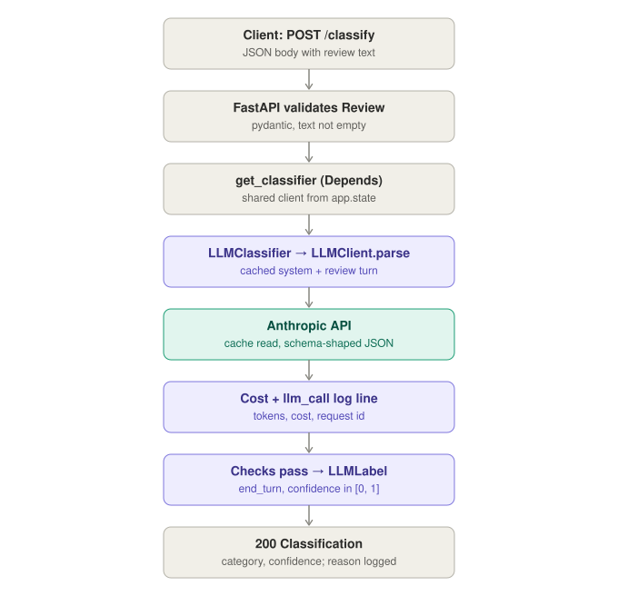
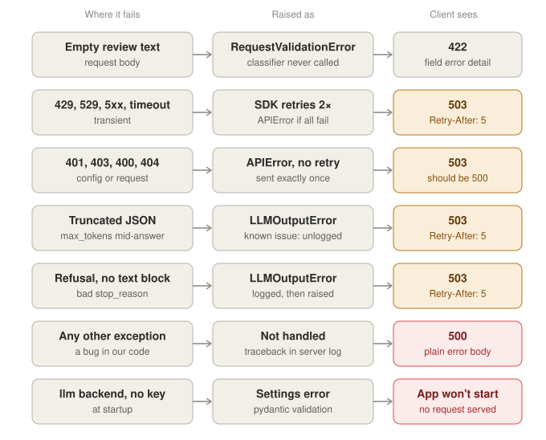

# review-river

[](https://github.com/YankaiW/review-river/actions/workflows/ci.yml)

A customer-feedback assistant for game reviews. It will do two jobs, and
prove with evals how well it does them:

1. **Classify and route**: each Steam review gets a category (bug,
   performance, payments, content, other) and a confidence score, so it
   reaches the right team.
2. **Answer questions**: "What do players complain about since the last
   patch?" gets an answer that cites the actual reviews (RAG).

**Status:** week 2 of 13. A FastAPI service with a swappable `Classifier`
port and two adapters: keyword rules (default) and Claude with structured
output, retries, prompt caching and per-call token and cost logging. Tests,
a Docker image and CI are in place. Retrieval and evals come next (see
[Roadmap](#roadmap)).

## Architecture

```
HTTP  ──►  api.py  ──►  Classifier (port)  ──►  KeywordClassifier   (default)
          (thin)          ▲                     LLMClassifier  ──►  LLMClient ──► Claude API
                          │                     fine-tuned model    (week 11)
                     deps.py: picks the adapter from settings
                          │
                     domain.py: Review, Category, Classification
                     (business rules, no framework imports)
```

Endpoints depend only on the `Classifier` protocol. Adapters are injected via
FastAPI's `Depends`, so tests swap in a fake and production swaps in an LLM
without touching the API code.

## Request flow

A successful `POST /classify` with the LLM backend:



Every way it can fail, and what the client sees. Provider and output failures
all become `ClassifierUnavailable`, which the exception handler turns into 503;
only unplanned exceptions give 500, so bugs never pass for outages.



## Quickstart

Requires [uv](https://docs.astral.sh/uv/) (it installs Python 3.12 if needed).

```bash
make install   # dependencies + pre-commit hooks
make run       # API with auto-reload on http://127.0.0.1:8000
```

Interactive API docs: <http://127.0.0.1:8000/docs>

```bash
curl -s -X POST http://127.0.0.1:8000/classify \
  -H "Content-Type: application/json" \
  -d '{"text": "Game crashes on startup"}'
# {"category":"bug","confidence":0.6}
```

### With the LLM classifier

Put an Anthropic API key in `.env`, then start the API with the LLM backend:

```bash
echo 'REVIEW_RIVER_ANTHROPIC_API_KEY=sk-ant-...' >> .env
REVIEW_RIVER_CLASSIFIER_BACKEND=llm make run
```

The same `curl` now returns Claude's label, e.g.
`{"category":"bug","confidence":0.97}`. Each call logs one line with model,
input, output and cache tokens, latency, cost in USD and the request id. If the
provider fails or the answer is unusable, the API returns `503` with
`Retry-After: 5`; other errors stay `500`.

### With Docker

```bash
make docker-build
make docker-run
```

Multi-stage image: dependencies are installed with uv in a builder stage; the
runtime stage contains only the virtualenv and runs as a non-root user with a
health check on `/health`.

## Configuration

Settings are read from environment variables (or a local `.env` file):

| Variable | Default | Meaning |
|---|---|---|
| `REVIEW_RIVER_APP_NAME` | `review-river` | Title shown in the API docs |
| `REVIEW_RIVER_CLASSIFIER_BACKEND` | `keyword` | Which classifier adapter to use: `keyword` or `llm` |
| `REVIEW_RIVER_LLM_MODEL` | `claude-opus-5-5` | Claude model id; must have a price in `llm.py` |
| `REVIEW_RIVER_LLM_EFFORT` | `low` | Reasoning effort per call: `low`, `medium` or `high` |
| `REVIEW_RIVER_LLM_TIMEOUT_S` | `10.0` | Timeout per API attempt in seconds |
| `REVIEW_RIVER_LLM_MAX_RETRIES` | `2` | Retries on connection errors, 408, 409, 429 and 5xx |
| `REVIEW_RIVER_ANTHROPIC_API_KEY` | none | Required when the backend is `llm`; never logged |

An invalid value, or the `llm` backend without a key, stops the app at
startup rather than failing on a request.

## Measurements

`make smoke` runs 20 hand-labelled reviews (`scripts/samples.jsonl`) through
both models, sequentially, with effort `low` and the system prompt cached:

| Model | Accuracy | $ per 1K reviews | p50 latency |
|---|---|---|---|
| `claude-opus-5-5` | 20/20 | 2.02 | 2.2 s |
| `claude-haiku-5-5` | 20/20 | 0.06 | 1.4 s |

Caching the ~1,500-token system prompt cut cost per review by about 70% on
both models. Twenty samples cannot separate the models on accuracy, and the
prompt's label rules were written after seeing them; the week 5 golden set
replaces this. Details in [LEARNING_LOG.md](LEARNING_LOG.md).

## Development

```bash
make check     # what CI runs: ruff lint + format check, pyright (strict), pytest
make format    # reformat and apply auto-fixes
make smoke     # compare models on the labelled samples (real API calls, ~$0.05)
make help      # all targets
```

Pre-commit runs ruff and pyright on every commit. CI runs `make check` and
builds the Docker image on every pull request and push to `main`.

```
src/review_river/
  domain.py      Review, Category, Classification
  classifier.py  Classifier port, KeywordClassifier and LLMClassifier adapters, system prompt
  llm.py         LLMClient: structured calls to Claude, typed errors, cost per call
  config.py      Settings from environment variables
  deps.py        Dependency providers for FastAPI
  api.py         FastAPI app: GET /health, POST /classify; lifespan owns the LLM client
tests/           unit tests per module, API tests with an injected fake; no network
scripts/         smoke_llm.py and the labelled samples it runs
```

## Roadmap

| Week | Adds |
|---|---|
| 2 ✅ | LLM classifier adapter: structured output, retries, token and cost logging, prompt caching |
| 4 | Ingest Steam reviews; embeddings, pgvector, hybrid search; `/ask` endpoint |
| 5–6 | Evals: hand-labelled golden sets, LLM judge calibrated against them, eval gate in CI, tracing |
| 10 | Deployment, caching, cost dashboard, prompt-injection defences |
| 11 | Fine-tuning experiment: embeddings + logistic regression vs prompted LLM vs LoRA |
